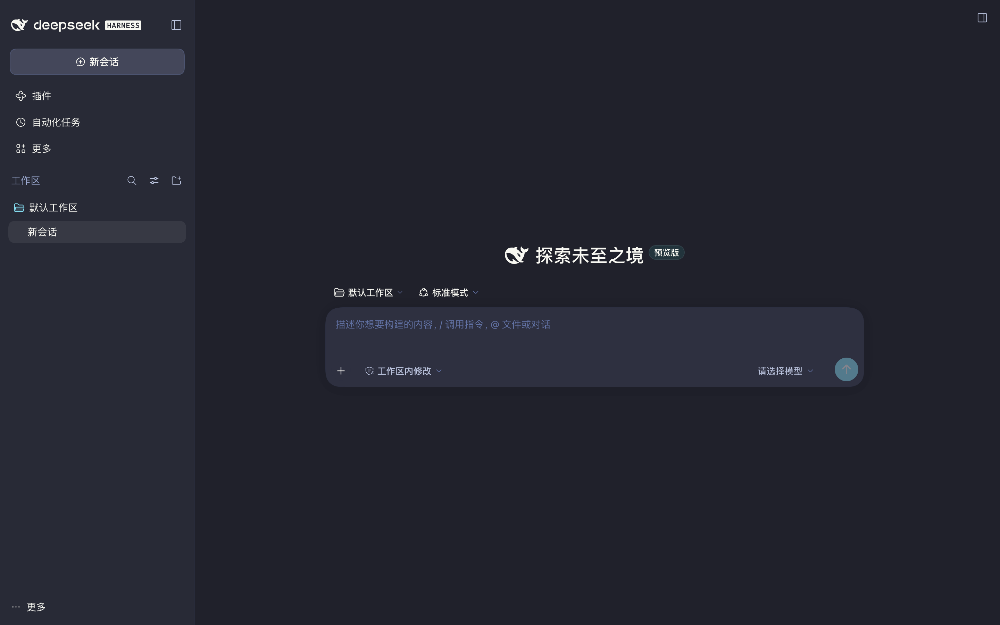
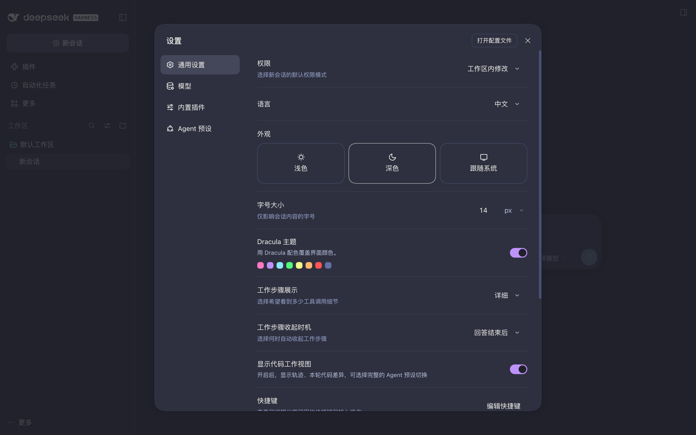
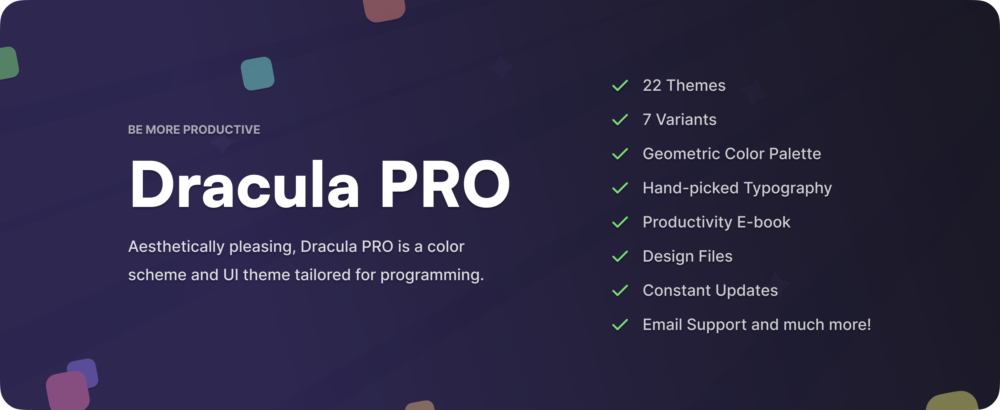

# Dracula for [DeepSeek Harness](https://github.com/deepseek-ai/deepseek-harness)

> A dark theme for [DeepSeek Harness](https://github.com/deepseek-ai/deepseek-harness) — sidebar, chat, composer, menus, and settings in Dracula colors.

Developed and maintained by [PuerJJJ](https://github.com/PuerJJJ), and hosted in the [Dracula organization](https://github.com/dracula). This is a community-developed theme, not an official DeepSeek plugin.

由 [PuerJJJ](https://github.com/PuerJJJ) 开发维护，收录于 [Dracula 组织](https://github.com/dracula)。社区开发，非 DeepSeek 官方插件。



Brings the [Dracula](https://draculatheme.com/) palette into DeepSeek Harness: the whole UI (sidebar, chat, composer, menus, settings, and code highlighting) is restated with `#20212B` / `#282A36` / `#44475A`, aligned with the [Dracula theme for the DeepSeek website](https://draculatheme.com/deepseek).



## Install

Open the **Themes** tab in [dsh-market](https://github.com/dsh-market/dsh-market), search for **dracula** or **deepseek-harness**, and choose the entry from **dracula/deepseek-harness**.

See the [installation guide](./INSTALL.md) for marketplace, Git, and manual installation instructions, also available at [draculatheme.com/deepseek-harness](https://draculatheme.com/deepseek-harness).

## Highlights

- **Full UI reskin**: 101 `--dsw-alias-*` tokens, 11 `--dsw-specific-*` tokens (sidebar / composer / bubbles / menus), 11 `--shiki-token-*` tokens (syntax highlighting), plus the think gradients and selection color — all restated with Dracula values.
- **Dracula on first paint**: the host half injects a `<style>` and a first-frame script with the HTML, so the built-in dark theme never flashes.
- **Leaves light mode alone**: only applies while the app is in a dark appearance; switching to light yields automatically.
- **Zero dependencies**: the host half uses Node built-ins only — no `@deepseek-ai/*` packages, no build step.

## How it works

The plugin has two halves, both hand-written with zero dependencies:

**Host half `lib/index.js`** — subscribes to `webserver/index-inject` and injects a `<style>` (into `<head>`) and an inline `<script>` (at the end of `<body>`) on every page render:

- Styles live under `:root:root body[data-dsh-dracula]{…}`. The doubled pseudo-class raises specificity to `(0,3,1)`, which beats the design-platform rules appended at runtime (`body`, `body[data-ds-dark-theme]`, `html[data-platform=darwin] body`) without relying on injection order.
- Covers four layers: `--dsw-alias-*`, `--dsw-specific-*` (without this layer the sidebar does not follow), `--shiki-token-*` (DSH highlighting uses `theme: "css-variables"`, so changing the variables is enough), plus the think/select gradients and `--dsh-boot-bg`.
- The first-frame script runs before any client bundle: reads the `localStorage` switch → exposes `globalThis.__DSH_DRACULA__` for the client half → toggles `data-dsh-dracula` on `<body>` from `body[data-ds-dark-theme]` → a `MutationObserver` follows later appearance changes.

**Client half `lib/client.js`** — a `window.__ModuleLoader__.load({ id: "dsh-theme-dracula", … })` bundle with `inject = ["theme", "slots", "locale"]`:

- Reads the current appearance from `ctx.theme.getTheme().active.colorScheme` and follows `ctx.on("theme/change", …)`;
- Registers a settings row on `settings.general.item` via `ctx.slots.register` (order 12): title / description / eight color dots on the left, a primitives `Switch` on the right;
- Writes the switch back to `localStorage`; `paint()` only runs `document.body.toggleAttribute("data-dsh-dracula", enabled && dark)`;
- Follows `storage` events, so a second DSH window stays in step when the switch is flipped elsewhere.

Copy is registered with `ctx.locale.register("dsh-theme-dracula", { zh, en })`.

> This is not registered as a third-party `ui-theme`: that API only persists `light | dark | system`, and any font or appearance change would push a third-party id back to a built-in value and silently drop the theme. A CSS skin layer that follows appearance state is more stable.

## Palette

| Role                           | Tokens                                                                                     | Value                                                     |
| ------------------------------ | ------------------------------------------------------------------------------------------ | --------------------------------------------------------- |
| Page background                | `--dsw-alias-bg-base`                                                                      | `#20212b`                                                 |
| Sidebar / code blocks          | `--dsw-specific-sidebar-fill`, `--dsw-alias-bg-layer-1`, `--dsw-alias-markdown-code-block` | `#282a36`                                                 |
| Cards / composer / hover       | `--dsw-alias-bg-layer-2`, `--dsw-specific-input-major`                                     | `#2e3040`                                                 |
| Selection / raised             | `--dsw-alias-bg-layer-3`, `--dsw-specific-sidebar-nav-item-active`                         | `#44475a`                                                 |
| Primary text                   | `--dsw-alias-label-primary`                                                                | `#f8f8f2`                                                 |
| Secondary / tertiary / caption | `--dsw-alias-label-secondary`, `-tertiary`, `-caption`                                     | `#bbc4de` / `#9ba9d0` / `#6272a4`                         |
| Accent / primary button        | `--dsw-alias-brand-primary`, `--dsw-alias-button-primary-fill`                             | `#bd93f9`                                                 |
| Links / focus                  | `--dsw-alias-link`, `--dsw-alias-state-business-primary`                                   | `#8be9fd`                                                 |
| Success / warning / error      | `--dsw-alias-state-success-primary` and related                                            | `#50fa7b` / `#ffb86c` / `#ff5555`                         |
| Syntax highlighting            | `--shiki-token-keyword`, `-string`, `-comment`, `-function`, `-parameter`                  | `#ff79c6` / `#f1fa8c` / `#6272a4` / `#50fa7b` / `#8be9fd` |
| Text selection                 | `::selection`                                                                              | `#bd93f9` at 42% over the background                      |

> Selection does not use Dracula's selection color `#44475a` directly: inline code uses the same background, so selecting a command would blend into the fill. A 42% purple overlay keeps the selection readable on the page, cards, and code blocks.

## Relation to the Dracula theme for the DeepSeek website

[draculatheme.com/deepseek](https://draculatheme.com/deepseek) is a Stylus userstyle for **chat.deepseek.com**. It works by overriding `--dsw-static-*` and Prism class names, and only applies on that domain in the browser.

This theme is the same palette mapped onto **DeepSeek Harness design tokens**: 32 of DSH's dark aliases are literal values, sidebar / composer / menus use a separate `--dsw-specific-*` layer, and highlighting uses `--shiki-token-*`. Porting only the static layer would leave large areas unthemed, so this version restates all three layers.

## Self-check

```bash
node scripts/verify.mjs
# optional: prove all 101 built-in alias tokens are restated
node scripts/verify.mjs --audit scripts/alias-tokens.txt
```

Checks host injection lines, CSS brace balance, first-frame script parseability, client-half switch / attribute wiring (including another window flipping the switch) under a stub environment, and palette completeness.

## Limitations

- **Terminal ANSI colors**: the terminal component derives its background, foreground and cursor from the theme, but xterm's 16 ANSI slots stay at the terminal's own defaults — only the surface follows Dracula.
- **JSON tree widget**: the tool-call JSON viewer writes its own per-element palette (`#5db0d7` / `#f28b82` / `#99c8ff`), which is element-scoped and therefore out of reach for token overrides.
- **Floating previews**: the hover card pins a dark `#2C2C2E` surface by design, in both light and dark appearance.
- **Appearance is respected, not overridden**: the skin only paints while the app is dark. Turning the switch on from a light appearance asks for the dark appearance once; switching back to light afterwards turns the skin off (and the settings row explains why).

## Team

This theme is maintained by the following person(s) and a bunch of [awesome contributors](https://github.com/dracula/deepseek-harness/graphs/contributors).

| [](https://github.com/PuerJJJ) |
| --------------------------------------------------------------------------------- |
| [PuerJJJ](https://github.com/PuerJJJ)                                             |

## Community

Join thousands of vampires using Dracula Theme around the world 🦇

- [X (Twitter)](https://x.com/draculatheme) and [Instagram](https://www.instagram.com/draculatheme) - Follow for tips, news, and fun.
- [Discord](https://draculatheme.com/discord-invite) - Hang out and chat with the rest of the clan.
- [GitHub Discussions](https://github.com/dracula/dracula-theme/discussions) - Ask questions and discuss issues.

## Dracula PRO

[](https://draculatheme.com/pro)

## License

[MIT License](./LICENSE)
